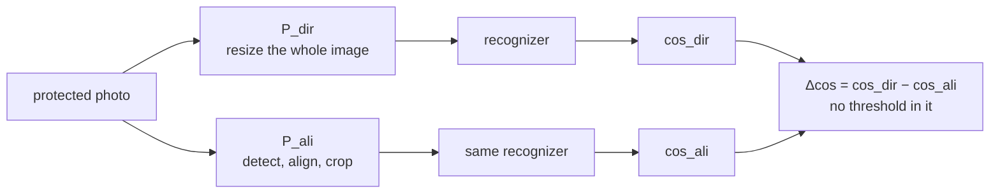

<div align="center">

# Wrong Input, Wrong Threshold

### Re-evaluating Adversarial Facial Privacy

**Tunahan Parlayıcı · Erchan Aptoula · Yücel Saygın**<br/>
Sabancı University


</div>

Adversarial facial-privacy methods report protection above 90% against black-box
face recognizers. That number comes from an evaluation protocol with two
independent defects, and the unit it is reported in cannot size either one.
This repository holds the measurement code, so that none of the three has to be
taken on trust.

## The three problems

| | what the literature does | what it costs |
|---|---|---|
| **Wrong input** | Feeds the recognizer the whole photograph, or at most a detector box. Deployed systems detect, align to a landmark template, and crop. | Re-scoring the *same protected files* through a realistic front end costs a standard transfer attack **56%** of its measured dodging protection, and a budget-allocating attack **7%**. Nothing is regenerated. |
| **Wrong threshold** | Reuses four verification constants inherited since 2021. | They hold the false-accept rate near its nominal 1% on aligned crops and admit **2.3 to 5.4%** on whole images. The bias has *opposite sign* for dodging and impersonation. |
| **Wrong measure** | Reports the gap as a difference of two success rates. | A success rate saturates at both ends. Over a budget sweep that difference moved by **8.2×** while the effect beneath it moved by **1.34×**. |

The cause of the first one is a resampling mismatch between the two front ends,
not perturbation lost outside the crop.

## One photograph, two front ends



Both cosines are taken against the file's own clean identity. Their difference
sizes the gap between the two protocols without any of the calibration the
paper disputes.

> [!IMPORTANT]
> **Sign convention.** Success means the protected photograph no longer matches
> its own identity (`sim < tau`), so a *lower* cosine is *better* protection.
> `Δcos < 0` means the whole-image protocol **overstates** protection.
> `Δcos > 0` means it understates it.

> [!NOTE]
> `Δcos` sizes the *protocol gap*. It is not an operational privacy metric: a
> shift of a given size does not convert to a verification error without a
> threshold and a population.

## The inherited thresholds, measured

False-accept rate of the four inherited constants on 500 clean FFHQ images,
against a nominal 1%, next to thresholds calibrated per front end.

| recognizer | inherited | calibrated, aligned | calibrated, whole image | FAR on whole images | FAR on aligned crops |
|---|---|---|---|---|---|
| IR152 | 0.167 | 0.179 | 0.202 | **2.32%** | 1.41% |
| IRSE50 | 0.241 | 0.271 | 0.311 | **3.67%** | 1.82% |
| FaceNet | 0.409 | 0.467 | 0.483 | **2.38%** | 2.04% |
| MobileFace | 0.302 | 0.288 | 0.402 | **5.36%** | 0.79% |

A threshold is a quantile of an impostor distribution, and that distribution
depends on what the recognizer is shown. It belongs to a recognizer *and* a
front end.

## Quick start

No dataset and no model weights are needed for any of this.

```bash
python src/dcos.py          # the measure and its algebraic self-check
python src/front_ends.py    # geometry of the two front ends
python src/calibrate.py     # per-front-end threshold calibration
```

```python
from src.dcos import dcos, identity_check, bootstrap_ci

# cos_dir, cos_ali: PAIRED cosines of the same protected files, scored through
# the whole-image front end and through a deployed one.
identity_check(cos_dir, cos_ali, tau_dir, tau_ali)   # no threshold may leak in
mean, lo, hi, n = bootstrap_ci(dcos(cos_dir, cos_ali))
```

```python
from src.front_ends import P_dir, P_ali, detect_landmarks
from src.calibrate import threshold, far_at

x_dir = P_dir(x, 112)                          # what the literature evaluates on
x_ali = P_ali(x, detect_landmarks(x), 112)     # what a deployed system sees

tau = threshold(E_clean)       # E_clean: embeddings through ONE front end
far_at(E_clean, 0.241)         # what an inherited constant really admits
```

## What is here

| path | what |
|---|---|
| [`src/dcos.py`](src/dcos.py) | the threshold-free measure, with the algebraic self-check |
| [`src/front_ends.py`](src/front_ends.py) | the two front ends, `P_dir` and `P_ali`, with a geometry self-test |
| [`src/calibrate.py`](src/calibrate.py) | thresholds calibrated per front end, and the false-accept rate a given constant produces |
| [`src/constants.py`](src/constants.py) | every measurement constant, in one place |
| [`survey/front_ends.csv`](survey/front_ends.csv) | what released codebases do at evaluation time, with the commit each was read at |
| [`docs/REPRODUCTION.md`](docs/REPRODUCTION.md) | which script produces which table, and what is still pending |

Still to land: the script that embeds a clean set and writes the thresholds,
the attack scripts (including the pipeline-aware remedy, which optimises
through `P_ali`), the budget and regression checks, and the stored measurement
outputs.

<details>
<summary><b>Why there is a self-check in a twenty-line function</b></summary>
<br/>

The gap can be written two ways: directly as `cos_dir - cos_ali`, or through
the margins with both calibrations still in it. The two are algebraically
identical, so if they ever disagree, a threshold has leaked into a measurement
that is supposed to be free of one, or the two arms are not paired.
`identity_check` computes both and raises. On the 35 stored runs behind the
paper the difference was exactly zero in double precision.

Two of the three errors we caught in our own work were silent: a key collision
that made four folders overwrite each other while the sample count stayed
right, and a resampling mismatch whose mean looked correct while its peak was
three times the nominal budget. Both were found by a check that compared a new
measurement against something already known. That is why the checks ship with
the code rather than living in a notebook.

</details>

<details>
<summary><b>What is deliberately not here</b></summary>
<br/>

- **No face images, protected or clean.** Redistributing identifiable faces
  would contradict the subject of the paper.
- **No datasets.** FFHQ, CelebA-HQ and LADN carry their own licences; see
  `docs/REPRODUCTION.md` for where to get each.
- **No model weights.** Sources are given instead.
- **No credentials.** Commercial endpoints are reached through environment
  variables; aggregate results only are published.

</details>

## Scope

This measures protections; it does not defeat them. The aligned front end here
reproduces what a deployed recognition pipeline already does, so a protection
that survives it is stronger than one that does not. The point of publishing
the pipeline is that a protection should be evaluated against the system it
claims to protect against.

## Citation

```bibtex
@misc{parlayici2026wronginput,
  title  = {Wrong Input, Wrong Threshold: Re-evaluating Adversarial Facial Privacy},
  author = {Parlay{\i}c{\i}, Tunahan and Aptoula, Erchan and Sayg{\i}n, Y{\"u}cel},
  year   = {2026},
  note   = {Manuscript in preparation}
}
```

The entry will be updated when the paper is published. See also `CITATION.cff`.

## Licence

MIT for the code, CC BY 4.0 for `survey/front_ends.csv`. Third-party components
are listed in [`NOTICE.md`](NOTICE.md).
